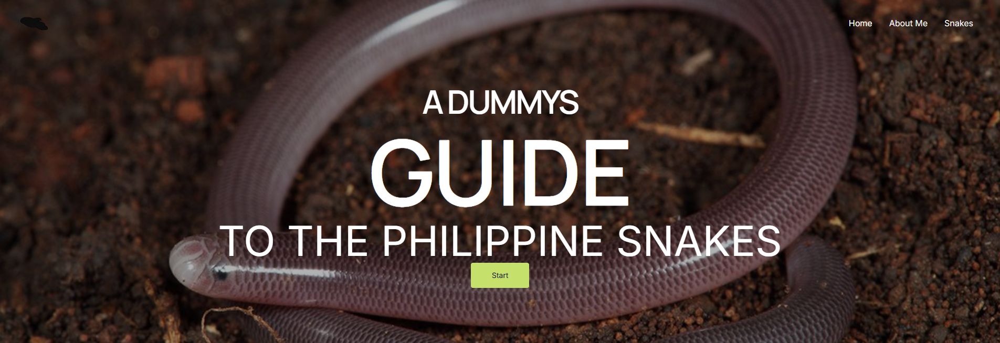

# A Dummy's Guide to the Philippine Snakes 🐍

An educational WordPress website that helps readers identify snakes found in the Philippines — from harmless blind snakes to pit vipers — in a beginner-friendly, approachable way.

**Live site:** [identifysnakesinph.freedev.app](https://identifysnakesinph.freedev.app)



## About the project

The Philippines is home to hundreds of snake species, and most people can't tell a harmless one from a dangerous one. This guide presents Philippine snake species in a simple, guided format so anyone can learn the basics — no herpetology background needed.

### Pages

- **Home** — bold, imagery-driven introduction with a guided "Start" flow
- **About Me** — who is behind the guide
- **Snakes** — the species guide

## Tech stack

| Layer | Technology |
| --- | --- |
| CMS | WordPress |
| Theme | Astra |
| Page builder | Elementor |
| Languages | PHP, HTML/CSS |
| Local dev | Docker Compose (WordPress + MySQL 8.0) |
| Hosting | [InfinityFree](https://www.infinityfree.com/) |

## Repository contents

| File | Description |
| --- | --- |
| `compose.yaml` | Docker Compose setup for the local development environment |
| `Screenshot_5.png` | Homepage screenshot |
| `README.md` | This file |

## Local development

The site is developed locally with Docker (WordPress + MySQL 8.0).

**Requirements:** [Docker Desktop](https://www.docker.com/products/docker-desktop/)

```bash
docker compose up -d
```

Then open <http://localhost:8080> and follow the WordPress setup wizard.

The stack includes:

- **wordpress** — WordPress (latest), exposed on port `8080`
- **db** — MySQL 8.0, database `wordpress`, user `wordpress`

> Credentials in `compose.yaml` are for local development only.

Data is persisted in the `wordpress_data` and `db_data` named volumes, so content survives container restarts:

```bash
docker compose down      # stops the stack, keeps volumes
docker compose down -v   # stops and removes all data
```

## Deployment

The live site is hosted on [InfinityFree](https://www.infinityfree.com/) free hosting. Content is managed through the WordPress admin; the Docker stack mirrors the environment locally so changes can be tested before they're applied to production.

## Author

Built by [Franz Lyster L. Tagalogon](https://github.com/8kshj1jh44) — full-stack web developer & WordPress specialist.

- Portfolio: [franz-portfolio-psi.vercel.app](https://franz-portfolio-psi.vercel.app)
- GitHub: [8kshj1jh44](https://github.com/8kshj1jh44)

Cheers to more websites! <3
